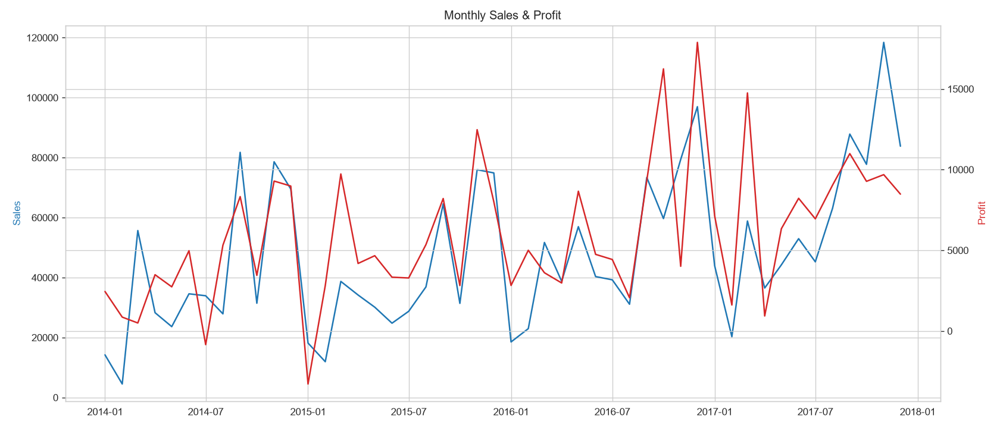
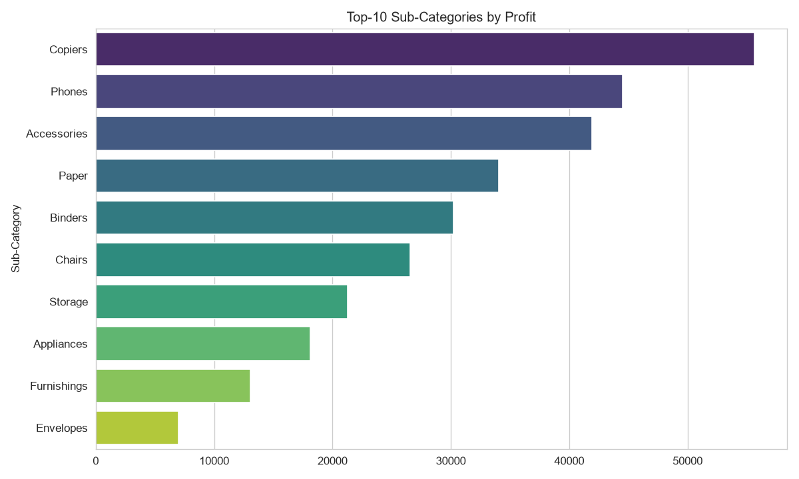
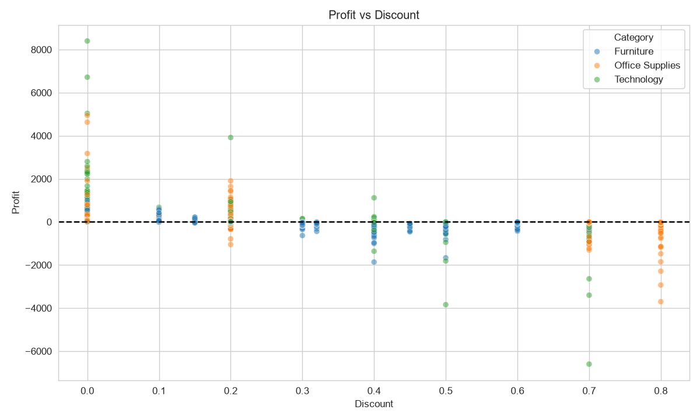

# 📊 Superstore Sales — EDA & Interactive Dashboard

Полноценный анализ продаж сети супермаркетов (2014–2017) с интерактивным дашбордом на Streamlit.


---

## 🎯 Цель проекта

Провести полный цикл анализа данных супермаркета:
- очистить и подготовить «грязные» данные;
- провести разведочный анализ (EDA);
- выявить ключевые бизнес-закономерности;
- собрать интерактивный дашборд для нетехнических пользователей.

---

## 🛠 Стек

- **Python 3.10+**
- **Pandas / NumPy** — обработка данных
- **Matplotlib / Seaborn** — статичные графики
- **Plotly** — интерактивные визуализации
- **Streamlit** — веб-дашборд
- **Jupyter Notebook** — EDA

---

## 📁 Структура проекта

```
project-eda-dashboard/
│
├── data/
│   └── Sample - Superstore.csv     # исходный датасет
│
├── notebooks/
│   └── 01_eda.ipynb                # полный EDA-анализ
│
├── app/
│   └── streamlit_app.py            # интерактивный дашборд
│
├── reports/
│   └── figures/                    # статичные графики (PNG)
│
├── requirements.txt
└── README.md
```

---

## 🚀 Быстрый старт

### 1. Клонировать репозиторий

```bash
git clone https://github.com/ТВОЙ_ЛОГИН/project-eda-dashboard.git
cd project-eda-dashboard
```

### 2. Установить зависимости

```bash
pip install -r requirements.txt
```

### 3. Запустить дашборд

```bash
streamlit run app/streamlit_app.py
```

Приложение откроется в браузере: **http://localhost:8501**

---

## 📸 Скриншоты

### Дашборд Streamlit


### Динамика продаж и прибыли


### Топ-10 подкатегорий по прибыли


### Зависимость прибыли от скидки


---

## 🔍 Ключевые выводы

### 1. Сезонность продаж
- **Пик продаж — ноябрь и декабрь** (праздничный сезон).
- **Провал — январь–февраль**.
- Продажи стабильно растут год к году (~+20%).

### 2. География
- **Самый прибыльный регион — West**, затем East.
- **Central — самый убыточный** из-за высоких скидок.
- Топ-штаты: California, New York, Washington.

### 3. Категории товаров
- **Technology** — лидер по прибыли (высокая маржа).
- **Furniture** — лидер по продажам, но **часто убыточен**.
- Топ-подкатегории: Copiers, Phones, Accessories.
- Убыточные: Tables, Bookcases, Supplies.

### 4. Скидки
- **Скидка > 20% почти всегда ведёт к убытку.**
- Оптимальный диапазон — 0–15%.
- Скидки 40–60% дают отрицательную маржу.

### 5. Сегменты клиентов
- **Consumer** — крупнейший по выручке (~50%).
- **Corporate** — самая высокая средняя маржа.

### 6. Логистика
- Средний Ship Lag: **4 дня**.
- Чем дольше доставка — тем ниже прибыль.

---

## 💡 Бизнес-рекомендации

1. **Ограничить максимальную скидку до 20%** — особенно в Furniture.
2. **Усилить маркетинг в West и East** в декабре.
3. **Пересмотреть ассортимент** Tables и Bookcases.
4. **Запустить программу лояльности** для Corporate-клиентов.
5. **Сократить Ship Lag** до 3 дней в Central.

---

## 👤 Автор

**Твоё Имя**
- GitHub: [SoYaMin1](https://github.com/SoYaMin1)
- Email: pandawow0700148815@gmail.com
---

## 📄 Лицензия

Проект создан в учебных целях. Датасет — [Sample Superstore](https://www.kaggle.com/datasets/vivek468/superstore-dataset-final).